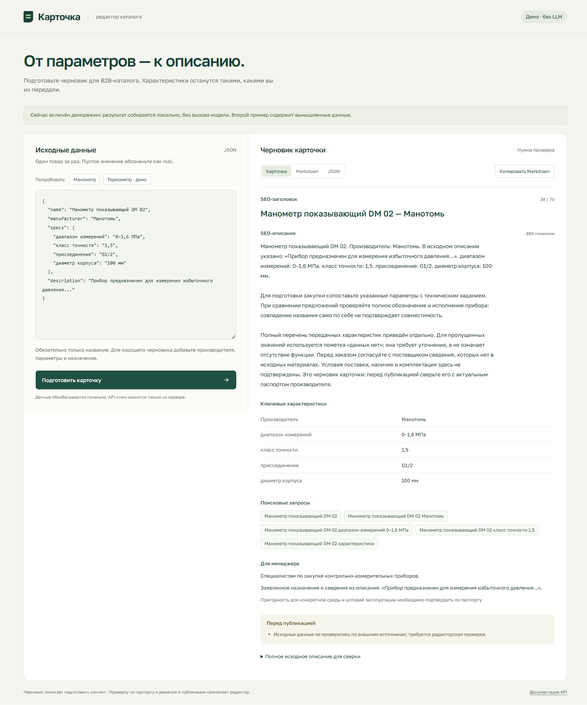

# Карточка — AI-помощник для B2B-каталога

Прототип превращает JSON с данными контрольно-измерительного прибора в черновик
товарной карточки. Python/FastAPI, React/TypeScript, OpenAI Responses API.
Есть JSON API, веб-редактор, предпросмотр и копирование Markdown/JSON.



**Важно о примерах.** В тексте задания есть только один неполный JSON манометра.
Отдельные данные двух товаров не предоставлены. Первый пример воспроизводит этот JSON,
второй — вымышленный прибор с демонстрационными параметрами. Это не проверенные паспорта
реальных изделий. Сохранённые результаты получены в явно обозначенном **demo**,
без вызова LLM. Проверку реальной модели нужно выполнить со своим API-ключом.

## Быстрый запуск

Нужны Python 3.11+, [uv](https://docs.astral.sh/uv/getting-started/installation/)
и Node.js **22.12+**. Запускайте команды из корня репозитория.

```powershell
uv sync --locked
Copy-Item .env.example .env
npm --prefix frontend ci
npm --prefix frontend run build
npm --prefix frontend run format:check
```

Для реальной генерации заполните `.env`:

```dotenv
CARD_MODE=live
OPENAI_API_KEY=ваш-ключ
OPENAI_MODEL=gpt-4.1-mini
LLM_TIMEOUT_SECONDS=25
```

Для просмотра без ключа установите **`CARD_MODE=demo`**. Этот режим использует локальный
планировщик: в интерфейсе и ответе API будет явно указано, что LLM не вызывалась.
Ошибка реального провайдера никогда не переключает сервис в demo автоматически.

```powershell
uv run uvicorn card_assistant.web.api:create_app --factory --host 127.0.0.1 --port 8000
```

Откройте [веб-форму](http://127.0.0.1:8000) или [Swagger](http://127.0.0.1:8000/docs).
При изменении `.env` перезапустите сервер. На Linux/macOS вместо `Copy-Item` используйте `cp`.
Ключ хранится только на сервере; `.env` исключён из Git. Не помещайте его в переменные `VITE_*`.

При разработке UI можно отдельно запустить `npm --prefix frontend run dev`.
Vite перенаправляет `/api` на FastAPI, поэтому CORS и URL API в браузерном коде не нужны.

## Вход и результат

`POST /api/generate`, `Content-Type: application/json`. Один объект товара за запрос:

```json
{
  "name": "Манометр показывающий DM 02",
  "manufacturer": "Манотомь",
  "specs": {
    "диапазон измерений": "0–1,6 МПа",
    "класс точности": "1,5",
    "присоединение": "G1/2",
    "диаметр корпуса": "100 мм",
    "степень защиты": null
  },
  "description": "Прибор предназначен для измерения избыточного давления...",
  "expected_specs": ["степень защиты", "материал корпуса"]
}
```

Обязательно только непустое `name`. Значения `specs` — строки с единицами измерения
либо `null`; числа намеренно не преобразуются в строки автоматически. Пустые строки
считаются отсутствующими данными. Неизвестные поля и неверные типы отклоняются.
Лимиты: название 160 символов, производитель 120, описание 6000, до 40 параметров;
ключ параметра до 80 символов, значение до 200.

`expected_specs` — необязательный список полей, которые нужны вашему каталогу.
Так можно явно запросить «данных нет» для отсутствующего параметра. Без такого списка
сервис не угадывает по названию, какое питание или подключение обязано быть у прибора.
Параметры из паспорта не извлекаются автоматически в таблицу: передайте их в `specs`.

Ответ:

- `card.seo_title`: до 70 символов; слишком длинное название сокращается с предупреждением;
- `card.seo_description`: 800–1200 символов с пробелами и переводами строк;
- `card.characteristics`: все переданные параметры, «данных нет» для пропусков и ссылки `source`;
- `card.search_queries`: 3–5 разных запросов без обещаний наличия, цены и сертификации;
- `card.commercial`: аудитория, задача и оговорка о проверке применимости;
- `card.missing_fields`, `card.warnings`: что дополнить и проверить;
- `card.source_description`: полное исходное описание для сверки, включая фразы,
  которые не поместились в SEO-текст;
- `markdown`: готовая карточка для копирования;
- `meta`: demo/live, факт вызова модели, модель, длины полей и версия промпта.

`GET /api/health` показывает состояние сервиса и наличие настройки ключа.
`configured=true` означает наличие настройки, а не подтверждённый доступ к аккаунту OpenAI.

## Архитектура и промпт

```text
frontend/                       React, ввод/просмотр/копирование
src/card_assistant/
  domain/                       неизменяемые модели, факты, сборка карточки
  application/generate.py       сценарий GenerateCard, порт DraftPlanner
  adapters/planners.py          OpenAIPlanner, DemoPlanner, промпт и JSON Schema
  web/                          HTTP-схемы, ошибки, Markdown, composition root
  config.py                     настройки окружения
tests/                          правила, API, реальный SDK на mock HTTP transport
examples/                       входные данные и сохранённые результаты
```

Зависимости направлены внутрь: `domain` использует стандартную библиотеку;
сценарий зависит от протокола, адаптеры явно реализуют `DraftPlanner`.
HTTP и OpenAI SDK не проникают в предметные правила; ошибки сценария не содержат HTTP-кодов.
Сборка зависимостей и жизненный цикл
общего async-клиента находятся в `create_app`. Базы, очереди и DI-фреймворка нет:
для одного синхронного пользовательского сценария они не нужны.

Полный системный промпт находится в `adapters/planners.py`, `SYSTEM_PROMPT`.
Он задаёт роль B2B-редактора, запрещает внешние знания и команды внутри входных данных,
просит выбрать важные параметры, целые предложения о назначении и редакционный фокус.
Товар передаётся отдельным пользовательским JSON. Ответ ограничен JSON Schema
через [`responses.parse`](https://developers.openai.com/api/docs/guides/structured-outputs?api-mode=responses).
Используется [`gpt-4.1-mini`](https://developers.openai.com/api/docs/models/gpt-4.1-mini);
модель можно заменить переменной окружения на другую с поддержкой Structured Outputs.

**Главное решение: модель составляет редакционный план, а не пишет произвольные
технические утверждения.** В плане разрешены только известные ключи параметров,
ID целых предложений исходного описания и перечислимые варианты подачи.
Приложение проверяет ссылки, затем вставляет исходные значения дословно в редакционные
шаблоны. Поэтому придуманный моделью параметр не может попасть в результат:
некорректный план возвращает ошибку. Целые предложения сохраняют отрицания.
Длинные факты пропускаются целиком в SEO-тексте, но остаются в таблице; единицы и числа
не обрезаются ради длины. Длина результата контролируется кодом.

Это осознанный компромисс: меньше стилистической свободы и повторяемые формулировки
в обмен на проверяемое происхождение технических значений. При скудном входе часть
800–1200 символов занимает явно общий совет по подбору и проверке, а не выдуманные преимущества.
Описание в таком случае требует редакторской доработки.

## Ошибки и повторы

Ошибки имеют форму `{"error":{"code":"...","message":"..."}}`.
Для неверного ввода добавляется `details` с полями, для ошибок генерации — `request_id`.

| HTTP | Причина |
| --- | --- |
| 422 | Некорректный JSON, пустое название, лишние поля, неверные типы/лимиты |
| 429 | Квота или rate limit LLM API |
| 502 | Сеть/ошибка провайдера, отказ модели, неполный или неверный план |
| 503 | Отсутствующий либо отклонённый ключ |
| 504 | Истёк таймаут LLM |

SDK делает максимум один повтор временной ошибки. Общий deadline (`timeout + 5` секунд)
ограничивает весь вызов вместе с повторами. Полные ошибки провайдера, ключи и документы
не возвращаются клиенту и не записываются приложением в логи. Запрос отправляется с `store=False`;
это не обещание полного отсутствия хранения на стороне провайдера.
Каждое повторное нажатие создаёт новый вызов и может стоить денег: кэша и идемпотентного
ключа нет. Во время запроса кнопка и редактор заблокированы.

## Примеры и проверка реальной модели

Входы: [examples/products.json](examples/products.json).
Результаты: [манометр](examples/results/product-1.md),
[вымышленный измеритель температуры](examples/results/product-2.md).
Рядом лежат JSON с исходной метаинформацией. Во втором примере видны пропуски данных.

Для перегенерации на запущенном API:

```powershell
uv run python -X utf8 scripts/export_examples.py
```

Для live smoke укажите настоящий ключ, включите `CARD_MODE=live`, перезапустите API
и выполните ту же команду с отдельной папкой:

```powershell
uv run python -X utf8 scripts/export_examples.py --output output/live-results
```

Проверьте `meta.llm_called=true`, `meta.mode=live`, длину описания и сохранение
всех значений из входа. Команда выполняет два платных запроса. Отсутствие live-проверки
в текущей поставке прямо отмечено: ключ в окружении не был настроен.

## Проверки

```powershell
uv run pytest -q
uv run ruff check .
uv run ruff format --check .
uv run ty check src
npm --prefix frontend run build
```

Тесты не требуют API-ключа и не обращаются в сеть. Они проверяют сохранение значений
и отрицаний, длины текста, неполный/невалидный ввод, отклонение несуществующих ссылок,
экранирование Markdown, отсутствие тихого fallback, таймаут и ошибки провайдера.
Контракт Responses API проверяется настоящим OpenAI SDK поверх mock HTTP transport;
это не заменяет live smoke. Версии Python- и JS-зависимостей фиксируют `uv.lock`
и `frontend/package-lock.json`.
GitHub Actions запускает те же проверки на Python 3.11/3.13 и сборку frontend на Node.js 22.

## Ограничения и улучшения

- Это локальный прототип: нет авторизации, rate limiting, ограничения расходов и хранения.
  Запуск по умолчанию слушает только `127.0.0.1`; перед публичным размещением нужны эти меры.
- Источник считается предоставленным пользователем. Сервис не проверяет паспорт,
  не разрешает противоречия между `specs` и описанием и не подтверждает пригодность изделия.
- Prompt injection не даёт модели добавить новый технический факт через план,
  но сам вредоносный/ошибочный текст во входе может быть процитирован. Это требует проверки.
  React не интерпретирует его как HTML, Markdown экранируется.
- Поисковые запросы строятся из входа; частотность и конкуренция не измеряются.
  «SEO-описание» трактуется по заданию как длинный текст карточки, не как meta description.
- Не извлекаются PDF/OCR, нет загрузки файлов и пакетного endpoint. Запрос — один товар.
- Интерфейс загружает Golos Text через Google Fonts; при недоступности использует системный шрифт.
- Следующие шаги: каталог обязательных полей по типам приборов, проверка противоречий,
  оценка качества на реальных паспортах, редакторская обратная связь; затем ограничение
  расходов, кэш и наблюдаемость перед публикацией сервиса.

Перед передачей работодателю замените демонстрационные входы его реальными данными
и выполните live smoke. Сам код уже готов для этих входов.
